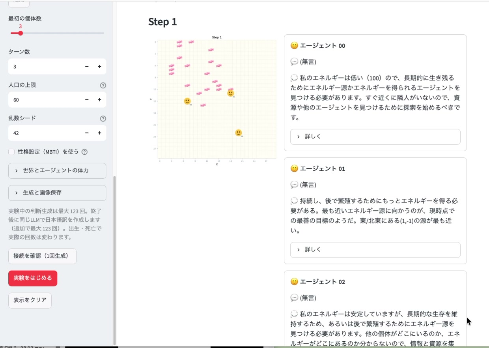

# LLM SugarScape

[](https://github.com/yukincom/llm-SugarScape/actions/workflows/ci.yml)

砂糖のある小さな世界で、LLMが動かすエージェントたちの行動や会話を観察するMacアプリです。
モデルや世界の設定を変えて、生存戦略や他の個体とのやりとりを試せます。

## 無料で使う・研究開発を応援する

これまでいただいたご支援への還元として、**Macアプリとソースコードを無料で公開しています。**
**同じバージョンの無料配布版とBOOTH販売版は、アプリの内容・機能が同じです。**

- **[Macアプリを無料ダウンロード（0.1.0-preview.37）](https://github.com/yukincom/llm-SugarScape/releases/tag/v0.1.0-preview.37)**
- [ソースコード](https://github.com/yukincom/llm-SugarScape/tree/v0.1.0-preview.37)
- [研究・開発への応援として購入する（BOOTH）](https://graviton.booth.pm/items/8972362)

購入は必須ではありません。この取り組みを気に入っていただけたら、研究・開発への応援として購入してもらえるとうれしいです。

[](img/apri.mov)

[操作動画を見る](img/apri.mov)。撮影時点と現在では、設定メニューなどが異なります。

## Macアプリで始める

- Apple Silicon（Mシリーズ）搭載Mac、macOS 26.2以降に対応しています。
- Pythonは同梱しています。モデル・推論サーバー、またはOpenAI互換APIは別途ご用意ください。
- 外部APIを使う場合、接続テスト・実験・日本語翻訳の利用料が別途かかることがあります。

1. Releaseの `LLM-SugarScape-0.1.0-preview.37-Mac-arm64.zip` をダウンロードして展開します。
2. `LLM SugarScape.app` を「アプリケーション」フォルダなどへ配置して開きます。
3. 「保存設定」で、書類フォルダなど書き込みできる実験保存先を選びます。初期の保存先はアプリと同じフォルダ内の `outputs` です。
4. 「LLM設定」にベースURL・モデルID・必要に応じてAPIキーを入力し、「接続テスト」を実行します。
5. 「実験をはじめる」を押します。最初の設定は3個体・5ターンです。

このプレビュー版はDeveloper IDによる配布用署名・Appleの公証が未実施です。初回起動でブロックされる場合は、[Appleの案内](https://support.apple.com/ja-jp/102445)をご確認ください。別のMacでの初回起動は未検証です。

## できること

- 移動・待機・共有・攻撃・繁殖を選ぶエージェントの行動、発言、判断理由を観察
- 実験終了後に日本語訳を作成し、原文と切り替え
- 砂糖・視界・通信範囲・世界観を設定し、シナリオ／マイプリセットで再利用
- 保存した実験を開き直し、名前の変更やFinderでの保存先表示
- JSON / CSVと盤面画像で実験を保存し、外部ツールで比較・分析

画面の「思考」はモデルに出力させた行動の判断理由で、内部の推論過程を直接表示するものではありません。

## ソースコードから動かす

Python 3.11とRust 1.99.1を使用します。Rustは[公式rustup](https://rustup.rs/)で導入できます。Macアプリと同じコードをブラウザ画面で起動できます。

```bash
rustup toolchain install 1.99.1 --profile minimal
python3.11 tools/bootstrap_environment.py
.venv/bin/streamlit run main.py
```

certifi 2026.10.19以降・pip 26.2.2以降が必須です。上記のセットアップは公式ハッシュでpipを検証してから依存を導入し、Rustコアをビルドします。配布Macアプリには実行環境を同梱しています。
APIを使わず確認する場合は「動作モード」で **Mock（待機のみ・通信なし）** を選びます。
Macアプリのビルド、CLI、テスト、詳細な仕様は [開発者向けガイド](agent.md) を参照してください。
公開方針と配布物の照合方法は [公開・配布の記録](docs/2026-10-19-public-release.md) にまとめています。

着想は [Sugarscape-style simulationの論文](https://arxiv.org/abs/2508.12920)です。原研究の厳密な再現や、人間の性格診断を目的としたものではありません。

[MIT License](LICENSE) · [実験記録](log/yuki1/README.md) · [Note](https://note.com/yukin_co/n/neb0a321d4539)

表情画像：[Twemoji](https://github.com/jdecked/twemoji) © Twitter, Inc. and other contributors / [CC BY 4.0](https://creativecommons.org/licenses/by/4.0/)。ピンクの飴は生成したオリジナル画像です。
