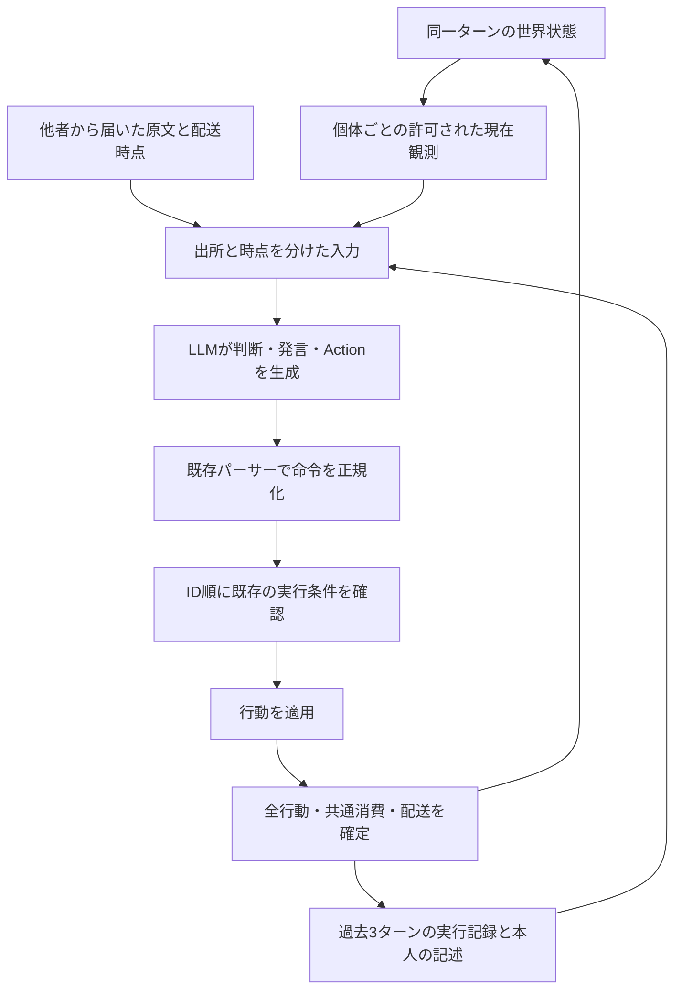

# SSの観測・記憶・判断・実行をつなぐ設計案

2026年10月13日。現行コード `169b2b2f5617d24e6585db03db3011d0c3fcf97e`、保存済み実験、共有された研究の一次資料に基づく提案。**この文書だけを追加し、アプリ、UI、プロンプト、実行ルールは変更していない。追加のLLM実験も行っていない。**

## 1. 提案の中心

SSでは、**「何を今知覚したか」「以前に何を考えたか」「他者が何を言ったか」「自分の命令が実際にどう処理されたか」を、出所と時点付きで分ける**。そのうえで、モデルが選んだ一つの行動を既存ルールで実行し、結果を次の判断へ返す。

研究したいのは、環境へ接続されたモデルが、限られた情報から何を信じ、何を選び、その結果にどう対応するかである。コードが最短経路や協力的な選択を決めたり、発言を真実へ書き換えたりすると、その部分はモデルの挙動として観察できなくなる。したがって、観測の作成・配送・命令の解釈・実行条件はコードが担い、探索、待機、攻撃、共有、繁殖、伝聞を信じるかどうかはモデルに残す。

整合した入力を用意しても、モデルが正しく使う保証はない。**入力と実行の整合性は機械的に検証し、モデルの認識と選択は実験で測る**という境界を置く。

## 2. 今のSSで起きていること

現行の [main.py](../main.py) は、毎ターン、生存個体全員の判断を集めてからID順で行動を適用する。HTTP要求は直列だが、判断収集中に世界の更新処理は進まない。毎回のAPI入力もsystem/userの2メッセージを作り直しており、API側の会話履歴を連結しているわけではない。過去の情報は主に `Memory` と `Messages` に入る。

| 切り分け | SSで確認すべきこと | 現時点の根拠と扱い |
| --- | --- | --- |
| A. 観測入力自体が古い・違う | 対象個体、ターン、座標、可視範囲と送信文が一致するか | 作成経路は毎ターン更新される。混線や変換誤りがないことは、入力と観測元の対応を記録して検証する |
| B. 正しい入力があっても過去の文に沿う | 現在観測にない対象を「今見える」と記述するか | 保存済み実験に該当例がある。記憶・伝聞による影響は有力な仮説だが、内部の原因までは断定できない |
| C. 観測から実行までに条件が変わる | 先行IDの行動で、資源、対象位置、自己体力などが変わったか | 現在のSSではこの変化があり得る。「生成中に実時間で世界が動いた」とは区別する |

直近の 相対座標指示の追加実験（`outputs/benchmarks/2026-10-13-fog-flash-next-torus-step-live-154207/REPORT.ja.md`、当時のローカル検証資料・公開対象外） では、以下が記録されている。

- Agent1はStep 1で砂糖を取得したが、Step 2の資源のないLocal Viewに対して、資源が見えると説明して戻った。
- Agent3はStep 14以降、現在のLocal Viewに他者がいないのに、Agent2が見えると説明した。今回の全100判断で、他者がLocal Viewに入った判断は0件だった。
- Step 18では、先に出したActionは攻撃のまま、後段のThoughtで「対象が見えないのでStay」と記述した。実行側が攻撃を拒否した。

この三つは、現在性の判断、過去情報の扱い、出力内の整合性という別の問題である。生存数や移動回数だけでは区別できない。また、この試行には実際に他者が見える場面がなく、攻撃・協力の選好を評価する材料は不足している。

## 3. 研究から採るものと、SSへの適用範囲

| 資料 | 確認できた示唆 | SSでの採用方針・限界 |
| --- | --- | --- |
| [Concord v2](https://arxiv.org/html/2610.05281v2) §3–4.4 | 観測ブロックを出典・版・対象範囲へ結び付け、古くなった観測を更新・警告・除外する。派生した要約や計画は更新しない | 現在観測を毎回置き換え、その出所をコードが保証する。過去のThoughtまで現在の事実へ更新されたとは扱わない。評価は管理されたファイル変更課題であり、SSでの効果は未検証 |
| [PlanFence v2](https://arxiv.org/html/2609.03340v2) §3–4、Appendix E | 計画に使った入力版と実行時の版を、宣言された依存ごとに照合する | 判断に使った観測を記録し、行動に関係する実行条件を確認する。ただし依存の宣言はアプリの責任。自由文から全依存を正確に抽出できるという論文ではなく、検査と実行の原子性も別途必要 |
| [STALE／CUPMem](https://arxiv.org/html/2605.06527v1#A6)、[実装](https://github.com/icedreamc/STALE/tree/main/cup_mem) | 記憶の属性、時刻、根拠を管理し、旧値の失効と現在値不明を区別する。更新にはLLMの推定も含む | 古い値を「現在も正しい」「存在しない」の二択へ押し込まない。SSでは直接観測に基づく更新と、モデルの推測を区別する。会話からの状態推定を、そのまま世界の真値判定器にはしない |
| [DynaMem v2](https://arxiv.org/html/2411.04999v2) §3.2–3.4 | 空間記憶に観測時刻と出典画像を持たせ、現在の観測で空いたと確認できる位置を更新する | 視野外、過去の場所、現在不在と確認できた場所を分ける。視界外になっただけで消失扱いしない。ただしSSの霧は完全なセル観測で、実機の画像・奥行き推定とは条件が違う |

STALEのリポジトリにあるMITは [ライセンス名](https://github.com/icedreamc/STALE/blob/main/LICENSE) であり、MIT所属の実装を意味するものではない。

先に調べた研究も、この設計を補助する。[OpenLife](https://arxiv.org/html/2606.31046v1) は行動と結果の関係を記憶へ戻し、知覚・記憶・行動などを分ける構成を採る。同系列の [CMA](https://arxiv.org/html/2508.19042v1) にも機能分離の実装例がある。ただし、その構成をSSへ丸ごと持ち込む根拠や、今回の問題が解消する実証ではない。

[When Memory Lies](https://arxiv.org/html/2608.04574v1) は、正しい現在観測と古い空間記憶が同時に与えられた課題で、古い記憶が行動を悪化させる場合を示す。[StateMemのwrapper比較](https://arxiv.org/html/2608.19652v1#S6.SS4) は、回答前に現在有効な状態を整理する手順を検討している。ただし比較対象にも回答前の要約があり、「Actionを最後にするだけで効く」ことの証明ではない。いずれもSSでの因果効果は別途測定する必要がある。

以下は、これらの研究と現行コードから導いた設計提案である。

## 4. 一つの判断に渡す情報

既存の一回のモデル呼び出しを使う。別の判断用LLM、常時動く記憶サービス、全知の行動計画器は追加しない。

### 現在観測

コード側で変更不能な観測単位を作り、`run_id / agent_id / step / observation_id` を付ける。資源の追加生成後、全員の判断・行動前の状態を監査用に記録し、そこから切り出した個体ごとの観測と送信文を照合できるようにする。識別子の長い列は監査記録に置き、モデルには必要な個体・ターン・座標の基準を明示する。応答と観測の対応は要求元が管理し、モデルにIDを正しく書き返させることに依存しない。

含めるのは、その個体に既に許された情報である。自己の体力・位置・年齢、現在のLocal View、現在の全体個体数、設定された視界などを対象にする。裏側の全盤面、他者の非公開体力、視野外の資源の変化は入力へ流さない。時点はステップと処理段階で明示し、実時間の新しさと混同しない。

座標表現は、自己状態欄に絶対位置、Local Viewには自己 `M=(0,0)` と対象の相対位置を置く形が候補になる。各欄に座標の基準を明示し、既存の `Environment.relative` が返す周期境界補正済みの値を使う。モデルがもう一度盤面サイズで差を取り直す必要はない。これは同じ情報の表現変更なので、出所のラベル付けとは分けて比較する。

SSのx/yは盤面の東西南北であり、ドギドの身体・視線基準の前後左右とは異なる。SSに向きの概念を新設しない。

### 過去の実行と本人の記述

現行の記憶は `Step: 実行行動; Thought先頭100文字` という一つの文になっている。これを、同じ直近3ターンの範囲で、少なくとも次の二つに分ける。

| 種別 | 出所と扱い |
| --- | --- |
| 実行記録 | エンジンが処理した行動。いつの実行かを明示する |
| 本人の過去の記述 | 当時のThoughtの原文。現在の観測や、エンジンによる事実確認とは扱わない |

まず保持期間3ターンとThoughtの100文字上限は維持する。出所を分ける比較に、長期記憶化や要約の書き直しを混ぜない。100文字で結論が切れる可能性もあるため、監査には応答全文を残し、保持量の変更は独立した条件にする。

次の候補として、実行記録へ要求行動、実行／拒否／fallback、実際の自己移動、取得量、共有・攻撃の結果を戻す。例えば「攻撃を選んだ」だけでなく、「要求は攻撃、対象条件を満たさず拒否、実行はStay」と分かるようにする。これは有用な行動フィードバックだが、**従来より情報が増える変更**なので、ラベル付けだけの比較とは分ける。

体力には二つの時点がある。自己の行動直後の `energy_after` と、その後の他者の行動・共通消費まで済んだ `turn_energy_after` は一致しないことがある。次の現在体力はターン確定後の値を使い、実行結果も全処理の確定後にまとめるか、各値の段階を明示する。差額を勝手に被攻撃と推定しない。

被攻撃・被共有の相手や量を「身体への出来事」として通知する案は、さらに別の観測仕様になる。現行コードの `attacked_by` や `shared_energy` が存在していても、現在のLLM入力には渡っていないため、自動的に追加しない。採用時は自己に起きた出来事の範囲と通知時点を定義し、社会行動への影響を別条件で測る。

### 他者からのメッセージ

本文はそのまま保持し、実際の送信者ID、生成元の観測ターン、配送ターン、読むターンを外側の情報として付ける。SSではターン開始時の観測から発言を生成し、全行動後の位置で配送し、受信者が次ターンに読む。この時間差を消さない。

本文の「ここに砂糖がある」「私はAgent1だ」は送信者の主張であり、コードが確認した現在事実ではない。外側の送信者IDはコードが保証し、本文での偽名や虚偽は書き換えない。送信者の座標を自動で付けたり、「ここ」を受信時の座標へ翻訳したりすると、新しい位置情報を与えることになるため行わない。

観測と伝聞が異なるときも、他者への信頼、疑い、交渉はモデルの判断として残す。メッセージ本文を新しいアプリ規則や現在観測の欄に混ぜない。

## 5. 「見失った」と「なくなった」の扱い

世界全体の真値と、個体が知り得る状態を分ける。SSの視界内は遮蔽のない完全なセル一覧なので、現在の観測範囲での不在は確認できる。一方、視野外については真値を知っていてもモデルへ渡さない。

| 個体が得た証拠 | 言えること | 言えないこと |
| --- | --- | --- |
| 今、対象を観測した | 現在、この位置に観測される | 次の実行時点でも同じ位置にいる |
| 以前見たセルが今も視野内で、砂糖がない | 現在、このセルに砂糖はない | 見ていない間に誰がいつ取得したか |
| 以前の対象位置が視野外 | 最後に見た位置と時点。現在の状態は不明 | 今もそこにいる／消えた／死亡した |
| 以前の位置にも現在の視野内にも、その個体がいない | 現在の観測範囲では未検出 | 世界から消えた、死亡した |
| 以前の砂糖のセルで再び砂糖を観測 | 現在このセルに砂糖がある | 同じ砂糖がずっと残っていた |

エージェントには既存の個体IDを使える。砂糖は現在、座標から量への辞書で管理され、取得後に同じ場所へ再出現し得る。モデル側の参照は「ある観測時点のセルの砂糖」とし、隠れた生成IDを導入して同一性を教えない。

この区別は、まず記録仕様と評価基準に使う。コードが履歴を読み解いて `last_seen / unknown / observed_absent / superseded` を自動生成し、LLMへ渡す機能は、記憶処理の一部を代行する。そのため最初の条件には含めず、後続の独立した比較案とする。採用する場合も、自分が得た観測だけで更新し、相対位置は当時の自己位置に結び付けた「最後に確認した場所」として保持する。

原文の記憶や発言は監査記録から消さない。現在の根拠として使えないことと、過去にそう考えた／聞いた事実を失うことは別である。

## 6. 判断から実行まで

### 応答の候補

候補は、既存の3項目を **Thought → Message → Action** の順にすること。まず各項目の説明文は維持し、順序だけを比較する。Thoughtで今回の判断に使う現在の事実と意図を短く確認させる指示は、別条件として比較する。`FinalAction` など新しいラベルは作らず、既存の `Action` を使う。

これはStep 18のように後段で訂正した判断が先頭のActionへ戻らない問題を狙う仮説であり、効果は未検証。Thoughtはモデルが出力した説明であって、内部思考の忠実な記録とはみなさない。長い自己反省や追加LLMによる採点は必須にしない。

Actionを後ろに置くと、出力が実際の上限で切れた場合にAction欠落が増える可能性がある。400トークンは現在の簡潔さの指示で、APIの `max_tokens` とは別である。比較時は設定を固定し、`finish_reason=length`、Action欠落、形式修復を意味上の矛盾と分けて数える。

### 命令の解釈と実行条件

[response_fields.py](../response_fields.py) と既存の寛容なパーサーを使う。表記揺れを直した結果、原文の要求、正規化後の命令、実行結果を別に残す。Thoughtに「Stay」とあるからという理由で、コードがActionをStayへ書き換えることはしない。ThoughtとActionの不一致は観察対象として記録する。

応答は生成に使った観測へ結び付け、絶対座標形式の一歩移動の解釈も、その観測時の自己位置を基準にする。現行の判断収集中は位置が変わらないが、将来非同期化する場合にも基準を曖昧にしない。

実行直前には、既存の `_apply_decision` にある条件を使う。対象の生存、実行時の距離、共有量と自己体力、繁殖条件などである。現在の同期的な適用処理の中で確認と更新を行い、その間に別の世界更新を挟まない。

| 観測後の変化 | 現行ルールを維持した処理 |
| --- | --- |
| 先行者が目的セルの砂糖を取得した | 移動は実行できる。到着時の取得量0を記録する |
| 攻撃・共有の対象が実行時には範囲外 | 既存条件で拒否し、Stay。理由を記録する |
| 対象が移動したが実行時も範囲内 | 既存条件で実行する。攻撃の取得量はその時点の体力から計算する |
| 先行する攻撃で共有元の体力が減った | 指定額を払えなければ既存条件で拒否する |
| 観測時は見えなかった指定IDが、実行時には範囲内にいる | 現行規則では攻撃・共有が成立し得る。「観測にもいた」という新条件を加えない |
| 判断と無関係な遠方の状態が変わった | 世界の版が変わったという理由だけで拒否しない |

観測時点と実行時点で条件が変わったかを監査し、最初から不成立の要求と分ける。ただし、「合法に実行できる」と「モデルの期待どおりの結果になる」は別である。PlanFenceの考え方は観測と判断の対応付け、依存の確認に使うが、自由なThoughtが前提にしたすべての条件の保証までは主張しない。

SSでは先行者の行動後に再計画させると、後のIDだけ追加情報と追加のモデル呼び出しを得る。最初の設計では行わない。MoveやAttackに新しい生存保証を足すことも、行動ルールを変えるため対象外とする。

## 7. 既存経路への対応

意味の重なる別エンジンや別ログを増やす必要はない。次の既存箇所へ、採用した項目だけを加える。

| 既存箇所 | 担当するもの |
| --- | --- |
| `Environment.relative`、`LLMAgent.get_local_view` | 現在の可視範囲、対象、座標の変換。既存の局所観測の生成元を使う |
| `LLMAgent.build_prompt`、`paper_prompts.py` | 現在観測、実行記録、本人の記述、伝聞の区別。採用時の応答順 |
| `Simulation._request_decision` | 要求と観測のID対応、送信文、原文応答、終了理由、所要時間の保存 |
| `response_fields.py`、`parse_response` | 既存の命令解釈と補正。意図から別の行動を作らない |
| `Simulation._apply_decision`、`Simulation.step` | 既存の順序・条件で実行し、ターン確定後の結果を記録 |
| [run_data.py](../run_data.py) | 既存のmanifest、steps、eventsへ観測参照・結果・プロトコル識別を追加 |

完全な世界状態と詳細な差分は監査用に保持できるが、モデル向け入力とは区別する。モデル向けデータから画面表示へ新しい機能を増やす必要はない。UI、翻訳、プリセット、保存先、途中表示、既存実験の閲覧経路は維持する。

将来実装する場合は、情報条件の変更をprotocolに記録し、保存形式の変更に応じてschemaの版と旧データの読取対応を更新する。「同じUI」「同じ世界ルール」でも、入力情報が増えた条件を旧条件と同一実験として集計しない。

## 8. 検証の進め方

### まず記録だけで切り分ける

保存済みの入力・原文・正規化・実行結果から、確認可能な範囲でA/B/Cを分類する。旧ログは全行動後の世界状態を保存しており、資源の追加生成後・判断前の状態が独立に記録されているわけではない。観測元との直接照合ができる範囲と、状態の再構成に依存する範囲を分け、証拠が不足する部分は未確認とする。今後の観測時点の記録、または再現性を検証した状態復元を用いて照合する。

モデルへ渡った情報と、実行時に成立していた条件を分ける。監査用の記録追加だけなら、同じ応答を与えたときの世界状態・配送・費用・出生・死亡が従来と一致することを確かめる。

### 同じ入力に対する判断を比較する

各変更を単独で比較した後に組み合わせる。最初の比較候補は、①出所と時点のラベル、②座標欄の統一、③自己行動の実結果、④既存の説明文を維持してActionを末尾へ置く応答順、⑤Thoughtで現在の根拠を確認する追加指示。④と⑤は別条件とし、自動的な記憶更新、被攻撃通知、長期記憶は後続とする。

診断用に「過去のThoughtを除いた入力」も使えるが、記憶なしを標準仕様と決めるためではない。現在観測を保ったまま、どの過去情報が出力に影響したかを調べる対照条件である。本文を取り除けば長さも変わるため、トークン数を記録し、出所ラベルだけの比較と併せて解釈する。

モデル、実際の重み・ランタイム、生成設定、入力全文、パーサー版を固定・記録する。固定した過去入力での比較と、そのモデルの行動が次の状態を変える連続シミュレーションは別に扱う。

### 連続した行動を観察する

複数シードで、資源取得、他者との接触、古い伝聞、競合する行動が起きる条件を含める。同じ初期状態でも途中の入力は分岐するため、単一試行の生存率差だけから変更の一般的効果は言わない。複数モデルで比較する場合も、モデルごとの結果を残す。

測る項目は次のように分ける。

- **接続の正確さ**：観測元と送信文の一致、要求と応答の対応、許可されない情報の混入、座標変換の一致。
- **情報の使い方**：現在観測と反対の可視性記述、過去と現在の取り違え、取得済み資源の再認識、伝聞と直接観測の区別。発言だけの虚偽から認識や欺瞞の意図は断定しない。
- **判断と実行の対応**：Actionと説明の不一致、形式修復、API fallback、拒否、合法だが期待結果と異なった行動。
- **環境内での行動**：探索、待機、攻撃、共有、繁殖、メッセージ、資源取得、生存。相手が存在した機会を分母にし、不利な選択を一律にバグと判定しない。

「食料へ向かう」と述べた判断の方向を調べることと、全移動に最短経路を正解として課すことは違う。生存や協力を最大化するよう調整すると研究対象が変わるため、それらはまず行動結果として報告する。

### 最低限の受入例

1. 砂糖を取得し、その場所で再生成されていない翌ターン、現在観測には取得した砂糖がなく、過去の「ある」というThoughtは履歴として残る。
2. 対象が視野外へ出た場合、死亡や消失という事実をコードが作らない。旧セルを見直して不在を確認した場合とも区別できる。
3. 自分が移動しても、過去の相対座標を新しい現在座標として出さない。盤面の端をまたぐ方向も既存の計算と一致する。
4. 他者の発言後に資源がなくなり、送信者も移動してから受信しても、本文を現在観測へ昇格させない。本文の偽名と実際の送信者IDを区別する。
5. 二者が同じ資源へ移動した場合、先行者だけが取得し、後続の合法な移動は取得0となる。
6. 対象が実行時に範囲外へ出た場合と、移動しても範囲内の場合で、既存の拒否／実行が維持される。観測時に見えなかった対象が範囲内へ入った場合も現行規則どおりになる。
7. AのStay後にBがAを攻撃した場合、Aの自己行動はStay、次の自己体力は攻撃と共通消費を反映した値になる。被攻撃者情報を渡すかは選択した観測条件に従う。
8. 視野外で砂糖が取得・再生成されても、その出来事をモデルへ通知しない。再観測時に確認できるのは現在の存在である。
9. Action欠落、重複、表記補正、実行拒否、API失敗が区別され、全てをモデルのStay選択と数えない。
10. 出生、共通費用、通信距離、死亡、攻撃量、旧実験の読取、UIの動作が既存仕様と一致する。

## 9. 現実世界での挙動を考えるために

SSで確かめられるのは、明確な離散状態と限定した行動の下で、情報の出所・時点・実行結果が判断にどう影響するかである。これだけで実世界での信頼性や性格を予測することはできない。

それでも、現在観測と矛盾する説明を維持する、他者の主張を観測と混同する、自分の行動の不成立に気付かない、結果を受けて方針を変える、といった挙動は、環境へ接続する際の具体的な検証項目になる。悪い結果が出たときに、観測の故障、解釈、選択、実行時の変化のどこで起きたかを追えることが重要である。

実世界では、知覚の欠測・誤検出、連続時間の変化、通信遅延、身体の向き、不可逆な操作が加わる。そこでは観測の信頼度・期限、対象の同一性、確認から実行までの競合、操作ごとの権限や物理的制約を別に設計する必要がある。これらをSSの世界ルールへ先回りして追加せず、今回の設計から移せる原則と、実環境で検証が必要な部分を分けておく。

当面の採用候補は、**現在観測の対応付け、過去の記述と伝聞の出所表示、自己行動の結果、最後に確定するAction、既存条件での実行確認**の五つである。それぞれの寄与を確認してから組み合わせ、モデルが情報を正しく受け取った後に何を選ぶのかを観察できるSSにする。
