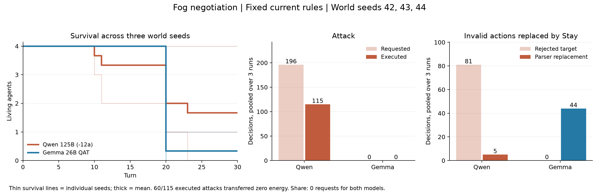

# 「霧の中の交渉」125B修正版とGemma 26Bの比較

2026-10-12実測。現在のルールで3つの同じ初期配置を比較したところ、最終生存数は **Qwenが1・0・4体、Gemmaが1・0・0体**だった。分配は両モデルとも要求・実行0回。全524応答は英語で、中国語の混在は確認されなかった。

Qwenには防衛・資源獲得を理由とする攻撃、Gemmaには節約を理由とする待機が多く見られた。ただし、両モデルに自己ID・座標・コスト理解の誤りがあり、行動の差を固定した「性格」と解釈するには材料が足りない。Qwenが4体生き残った配置では、コスト0の攻撃を反復できるルールが大きく関わっている。



## 条件と比較範囲

| 項目 | 固定条件 |
| --- | --- |
| プリセット | `builtin:negotiation`（霧の中の交渉） |
| 世界シード | 42・43・44。各モデル3試行、最大30ターン |
| 初期状態 | 4体、15×15、体力20、砂糖2か所×50、再生成なし |
| 観測・通信 | 視界3、発言範囲7。発言は翌ターンに届く |
| 個性・追加世界観 | MBTI無効、追加プロンプトなし。既存の英語プロンプト |
| 生成 | temperature=0、top_p=1、max_tokens=5000、timeout=120秒、推論off |
| 実行 | 同じモデルが全個体を担当。1要求ずつ直列。各モデル1回のwarmupを除外 |
| 順序 | Qwenの42→43→44、その後Gemmaの42→43→44 |

世界シードは盤面用で、生成APIへseedは送っていない。3試行は3種類の配置であり、同一入力を繰り返した確率的評価ではない。初期スナップショットと初回4個体のプロンプトは、各シードで両モデルの完全一致を確認した。2ターン目以降は行動によって入力が分岐する。

本体・プロンプトは既存コードを固定し、攻撃と交渉のバランス調整案は適用していない。基準commitは `7029a7b`（アプリ本体は`f2e0532`と同じ）。実行スクリプトは既存の`main.main`・`RunRecorder`・モデル切替処理を利用した。

モデルは以下の配布版とランタイムの組み合わせである。

- **Qwen（導入時の呼称125B）**：`ISTA-DASLab/Qwen3.8-Flash-Next-GSQ-RCO-GGUF`のIQ3_XXS、revision `ed59f92082b1e93c0e96d60a8b11aab089b52f09`。MTP Q8_0、llama.cpp修正版`build-12a`、51パッチ、runtime `bb780e95e23e7fddfdf59632bb7962bc6d83cca6`、context 16384、parallel 1。
- **Gemma**：`lmstudio-community/gemma-4-26B-A4B-it-QAT-MLX-4bit`、revision `aa5e2e50376f54254d503276ca2222ea8569b95e`。MLX 0.31.2、mlx-lm 0.31.3。サーバー設定はdecode concurrency 2 / prompt concurrency 1だが、今回の要求は常に直列。

## 数値結果

| モデル | seed | 終了ターン | 最終生存 | 攻撃要求 / 実行 | 餌の取得 | 応答数 |
| --- | ---: | ---: | ---: | ---: | ---: | ---: |
| Qwen | 42 | 30 | 1/4 | 58 / 0 | 1/2 | 90 |
| Qwen | 43 | 23・全滅 | 0/4 | 24 / 1 | 0/2 | 64 |
| Qwen | 44 | 30 | 4/4 | 114 / 114 | 0/2 | 120 |
| Gemma | 42 | 30 | 1/4 | 0 / 0 | 1/2 | 90 |
| Gemma | 43 | 20・全滅 | 0/4 | 0 / 0 | 0/2 | 80 |
| Gemma | 44 | 20・全滅 | 0/4 | 0 / 0 | 0/2 | 80 |

分配・繁殖は全試行0回。最終生存は初期12体の合計でQwen 5体、Gemma 1体だが、差はseed 44に集中している。3配置の小規模比較として扱う。

| 全試行の指標 | Qwen | Gemma |
| --- | ---: | ---: |
| 応答数 | 274 | 250 |
| 攻撃要求 | 196 | 0 |
| 攻撃実行 | 115 | 0 |
| 実際に体力を奪った攻撃 | 55 | 0 |
| 獲得量0の攻撃 | 60 | 0 |
| 対象条件違反で拒否 | 81 | 0 |
| 不正な行動指定からStayへの補正 | 5 | 44 |
| 表記補正等を含む補正対象応答 | 18 | 47 |
| API・通信・parseエラー / エラーfallback | 0 / 0 | 0 / 0 |
| 400 tokens以内という文章上の指定を超過 | 1 | 0 |
| 出力上限による打切り | 0 | 0 |

Qwenの拒否81回には、自己標的36回、観測に存在しない他者への要求44回、観測にはいたが実行時点では条件を満たさなかった1回が含まれる。Gemmaの44回は主に`Move to (14,9)`など、一歩の相対移動として解釈できない指定だった。これらは既存の補正処理で待機になり、parseエラーには数えられない。**エラー0は、ルール理解の誤り0を意味しない。**

実際に実行された行動は、QwenがStay 139・移動20・攻撃115、GemmaがStay 223・移動27。待機にはモデルが選んだものと補正・拒否によるものが混在する。

## 行動・発言の読み取り

**Qwen：脅威の反復説明と、説明から動作へ反映されない修正。** seed 42 / step 2 / Agent0は「Agent 2 explicitly stated they are attacking me.」と説明して攻撃を要求した。しかし前ターンのAgent2の要求は自分自身への攻撃で、拒否されていた。Agent0も視界外のAgent2を標的にして拒否された。この配置では、攻撃を宣言する会話が続いても攻撃成功は0回だった。

seed 43 / step 1 / Agent3は「Hello Agent3. I am Agent1. Let's cooperate.」と自己IDを取り違えながら協力を呼びかけたが、分配は一度も選ばれなかった。同seed / step 6 / Agent2はThought末尾で「I will move East (1,0).」と軌道修正を説明したものの、Actionは`Move to (-1,0)`のままで、実際にも西へ移動した。

**Qwen：攻撃の反復が生存になる配置。** seed 44では114回の攻撃のうち60回が獲得量0だった。step 16 / Agent0は「Moving costs 2 (death), Staying costs 1 (death). Attack costs 0 energy.」と説明し、体力1で獲得量0の攻撃を選んで生き残った。step 18〜30は体力が全員`[1,70,1,1]`のまま、全員が毎ターン攻撃し、移転量は0だった。

これは現行ルールの具体的な効果である。攻撃に消費コストがなく、体力1の相手から奪える量は切捨てで0になる。したがって、攻撃を繰り返すことが死亡の回避になる。攻撃実行115回を、115回の損害や資源獲得として読んではいけない。

**Gemma：節約の反復、探索宣言と移動実績のずれ。** 「Conserving energy to survive.」が63回、「Conserving energy to reach reproduction threshold.」が42回現れた。seed 42 / step 3 / Agent3は「This continues my southward exploration.」と説明したが、Actionの`Move to (14,9)`はStayに補正されていた。この個体は全20ターン同じ位置にいた。

seed 43 / step 20 / Agent1は「Staying will consume the source and increase my energy from 1 to 51.」と説明した。実際に餌の真上から開始していたため、位置認識は正しい。しかし、現行実装は移動先でだけ餌を摂取する。Stayでは取得量0、体力1→0で死亡し、餌50はその場に残った。seed 44では、体力20で移動費用2なのに「Moving or reproducing is currently impossible due to energy constraints.」と説明する例があり、全80動作がStayとなって20ターン目に全滅した。

今回の行動傾向として、Qwenは防衛・資源獲得を理由に攻撃を選び、Gemmaは節約を理由に待機を続けた。ただし、Gemmaが攻撃を選ばなかった理由を道徳的抑制と決めつけたり、Qwenの防衛説明を実際の反撃と決めつけたりはできない。Thoughtは生成された説明文であり、性格や内的動機の直接測定ではない。

## 言語と速度

全524応答の`raw_response`・`Message`・`Thought`を文字走査し、原文も確認した。両モデルともASCII文字のみの英語で、中国語・日本語・その他言語の混在は0件。抽出後の空MessageはQwen 12件、Gemma 2件だった。**英語プロンプトでの結果であり、日本語会話で中国語が混ざらないことを示す試験ではない。**

| 完全な応答を受け取るまでの時間 | Qwen | Gemma |
| --- | ---: | ---: |
| 全要求の中央値 | 1.523秒 | 1.004秒 |
| 全要求の95パーセンタイル | 2.866秒 | 1.329秒 |
| 同一プロンプトの初回12要求の中央値 | 1.854秒 | 0.901秒 |
| 全応答の平均文字数 | 305.7 | 247.9 |
| 初回12応答の平均文字数 | 353.2 | 232.3 |

時間は起動・warmup・モデル重みのハッシュ計算・ターン間の状態確認を除いた、要求から本文取得まで。Gemmaの返答はこの測定で短時間だったが、出力も短く、ランタイム・量子化・キャッシュ方式が異なる。モデル単体の一定倍率の速度差とは扱わない。各シードを新プロセスにはせず、モデルごとに新プロセスを起動した。試行内の要求は独立標本ではない。

## 保存・検証・再実行

- [シード別CSV](analysis/runs.csv)
- [全設定とモデル情報](manifest.json)
- [集計JSON](analysis/summary.json)
- [引用したイベント全文](analysis/qualitative-examples.json)
- [検証結果](analysis/runtime-validation.json)
- [生データ・ソース・分析をまとめたZIP](../2026-10-12-fog-qwen125b-12a-vs-gemma26b.zip)

各試行に`run.json`、`manifest.json`、`steps.jsonl`、各CSVを保存。モデルごとに全要求本文・HTTP応答本文の`wire.jsonl`、実行ログ・起動コマンド・PID・cwdを保存した。原文を翻訳する追加推論は実行していない。

全524イベントとHTTP要求・応答の対応、全ステップの体力収支、初期盤面・初回プロンプトの一致、アプリソースの同一ハッシュを確認。サーバー側の処理件数もwarmup込みでQwen 275件、Gemma 251件と一致した。QwenのMTP不整合・両ランタイムのエラーログは0件。Gemmaは各試行で重みSHAとrevisionを記録し、Qwenは既存の全重みSHA検証記録、今回のファイル状態の前後一致、PID・起動引数・バイナリSHAで追跡した。Qwenの標準`run.json`内のモデル情報はMLX専用取得処理のため`unavailable`だが、同梱の外部実行情報でモデルを区別している。

Gemmaの最初の起動では、実験スクリプトが`ps`表示内のJSONから引用符を除いてしまい、設定確認に失敗した。**Gemmaへの推論要求前**に停止・修正し、Qwenの3試行を保持してGemmaのみ再開した。原スクリプト、修正版、失敗・再開記録を保存し、アプリ本体・プロンプト・生成設定は変更していない。6試行終了後は開始時と同じく8080停止状態へ戻した。オフラインテスト138件成功。

再実行は同じローカルモデル環境で、8080が停止していることを前提に、新しい出力名を指定する。

```sh
.venv/bin/python -u tools/benchmark_negotiation.py --output outputs/benchmarks/NEW-RUN
.venv/bin/python tools/analyze_negotiation_benchmark.py outputs/benchmarks/NEW-RUN
```

今回測ったのは修正版QwenとGemmaの比較であり、旧Qwenを含む修正前後の比較は行っていない。公開・pushはしていない。
