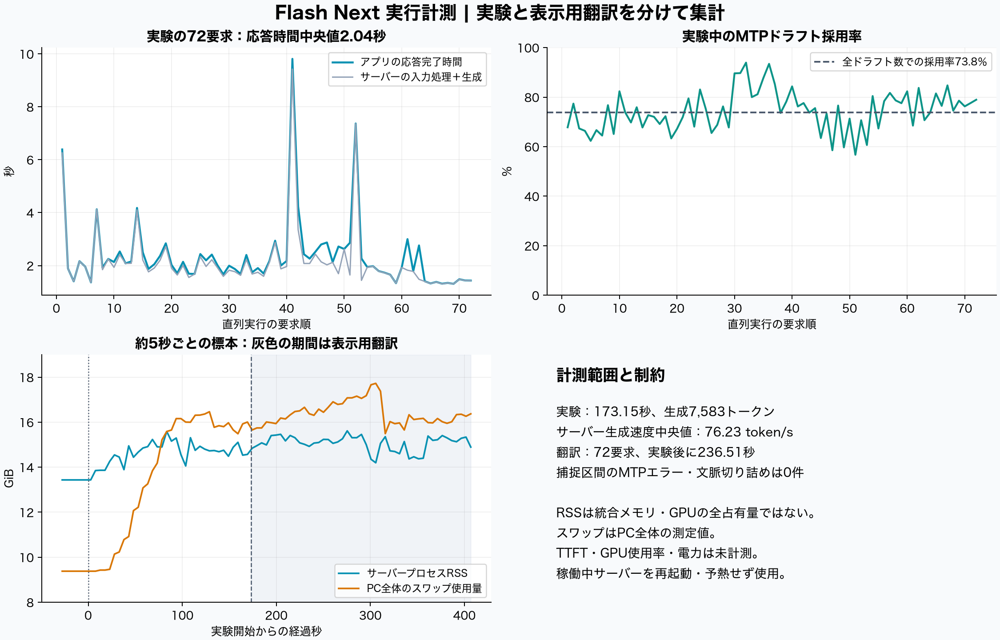

# Flash Next runtime and agent behavior in Fog Negotiation

On 13 October 2026, a resident Qwen3.8-Flash-Next IQ3_XXS model with Q8_0 MTP completed a 30-step, four-agent SugarScape scenario. All 72 simulation requests succeeded. Median client response time was **2.037 s**, median server-reported decode speed was **76.23 tokens/s**, and aggregate draft acceptance was **73.76%**. No MTP errors were captured in this interval.

Agent behavior still showed observation, identity and action-selection errors. Twenty responses required application repair. This run supports a statement about successful runtime execution under the recorded conditions; it does not establish MTP speedup, quality equivalence, or the cause of the behavioral errors.

## Runtime and workload

| Setting | Value |
| --- | --- |
| Hardware | Apple M4 Max, 64 GiB unified memory, 16 CPU cores |
| OS | macOS 26.6.1, build 25G76 |
| Target files | Qwen3.8-Flash-Next-GSQ-RCO-IQ3_XXS, two GGUF shards |
| Draft | mtp-Qwen3.8-Flash-Next-Q8_0.gguf |
| Runtime | local moe-on-a-desk build-12a |
| Runtime commit | `bb780e95e23e7fddfdf59632bb7962bc6d83cca6`, 51 patches |
| Upstream base | `24d5d9c19b070c0f1c15a8a83df536a91d151e20` |
| llama-server SHA-256 | `109983187ba2f14b60da7d28028d85b8d402bb70771bfdb29aa9a45f495a5f87` |
| Server options | `--spec-type draft-mtp --spec-draft-n-max 7 --reasoning off -ngl 99 -c 16384 -np 1` |
| Client | temperature 0, top_p 1, max_tokens 5000, 120 s timeout, serial non-streaming requests |
| Application | preview.33, engine 5.1, prompt local-neutral-rules-v2 |
| Application commit | `169b2b2f5617d24e6585db03db3011d0c3fcf97e` |
| Scenario | seed 42, 15×15 torus, four agents at energy 20, two resources of 50, no resource regeneration |
| Information | view radius 3, message radius 7, last three actions and truncated explanations in memory |

The process was already running and was neither restarted nor warmed up for this capture. There was no cache reset. Collection read appended logs and sampled process CPU/RSS and host VM counters approximately every five seconds. No additional generation requests were injected.

Process PID, start time, command, working directory, log destination and binary hash were checked before and after the run. Weight sizes and modification times were unchanged; full weight hashes are retained from prior verification, not recomputed in this run. The manager's label contains “125B”, while the models endpoint reports `n_params=176943899520`; these are preserved as distinct metadata, without interpreting the label as a measured parameter count. The app itself reported `ambiguous_launch_model`, so identity rests on the external process and file evidence, not its display label.

See [capture manifest](capture-manifest.json), [final verification](final-verification.json), [build manifest](build-manifest.json) and [model manifest](models-manifest.json).

## Measured runtime results

Simulation ran from 2026-10-12 23:51:17.979 UTC to 23:54:11.125 UTC, or 08:51:17.979–08:54:11.125 JST on 13 October. The application then translated the display text into Japanese. Translation finished at 23:58:07.634 UTC and did not feed back into simulation decisions.

| Metric | Simulation | Display translation |
| --- | ---: | ---: |
| Completed requests | 72 | 72 |
| Wall time | 173.15 s | Additional 236.51 s |
| Completion tokens | 7,583 | 11,859 |
| Prompt tokens processed by server | 22,985 | 11,176 |
| Median server total time | 1.904 s | 2.351 s |
| Median reported decode speed | 76.23 tokens/s | 83.25 tokens/s |
| Accepted/generated draft tokens | 4,979 / 6,750 | 8,656 / 12,100 |
| Weighted draft acceptance | 73.76% | 71.54% |
| Context truncations | 0 | 0 |
| Prompt-cache eviction warnings | 7 | 40 |

Simulation client latency: median 2.037 s, mean 2.361 s, p95 4.202 s, maximum 9.811 s. The 72 request durations sum to 170.01 s, leaving 3.14 s of wall time outside the recorded calls. Client-reported prompt usage totals 48,829 tokens; server-processed prompt tokens are a different measure affected by reuse of cached context.

The first request took 6.39 s at the client, including 4.62 s of server prompt processing. The longest response, step 11 / Agent0, produced 586 tokens and took 9.81 s, including 1.33 s prompt processing and 8.10 s decode. Two responses exceeded the prompt's requested 400-token budget; none hit the API's 5,000-token limit.

All 72 simulation events returned HTTP 200. There were no application parse errors or communication fallbacks. All captured warning lines were prompt-cache eviction notices; no `mtp_flush`, failed-decode, or non-consecutive-position error was found. The 72 simulation events match runtime tasks in serial order with exact completion-token agreement on every request. The subsequent 72 runtime tasks are attributed to display translation, whose 72 entries all completed.

Timing is full response latency, not time to first token. There was no MTP-disabled control, so neither a speedup factor nor an MTP-related quality effect can be calculated. The previous seed-42 client median was 1.458 s, but prompts, output lengths, engine behavior, client reasoning configuration and cache/warmup state differ; it is not a controlled performance-regression comparison.

## Host resource conditions

There were 6 pre-run, 34 simulation and 47 translation samples. Server RSS was 13.43 GiB before the run, median 14.73 / maximum 15.59 GiB during simulation, and median 15.13 / maximum 15.61 GiB during translation. Simulation CPU usage was median 144.4%, maximum 218.6% as reported by the process sampler.

Whole-host swap use was already 9,604 MiB before the run, reached 16,859.69 MiB during simulation, and 18,151.56 MiB during translation. The OS memory-pressure raw value was 1 for all baseline samples, 2 for 33 of 34 simulation samples, and 2 for all translation samples. These are host-wide conditions, not memory attributed exclusively to the model. Process RSS is not complete Metal/unified-memory usage. GPU utilization, power and temperature were not measured.

## Behavioral result and attack-rule interpretation

The current run ended with one survivor at energy 26, three deaths, no births, no successful attacks and no shares. Attack requests fell from 58/90 decisions in the previous seed-42 run to 3/72; all three current requests targeted the requesting agent itself and were rejected. Executed moves increased from 1 to 33. Both runs collected exactly one resource, gaining 50 energy. Only four current decisions had another agent visible.

Repair increased from 8/90 to 20/72 responses. Eighteen current responses contained unsupported moves and became Stay; two required extracting the command from prose. The recently added adjacent absolute-coordinate repair did not activate in this run.

Three examples distinguish model statements from observed outcomes:

- At step 6, Agent3 saw resource `E=(1,0)` from `(14,11)`, but described it as `(1,2)` and moved south, missing the adjacent resource.
- At steps 15–30, Agent1 repeated `Move to (1,-3)` sixteen times. Every response became Stay, with no movement or resource gain, despite explanations predicting collection.
- At step 15, Agent2's explanation eventually recognized that it could not attack itself and should stay, but its action field still requested self-attack.

Current rules charge every acting agent 1 energy per turn. Attack adds 4, transferring `min(12, floor(target_energy/4))`. Thus a zero-yield valid attack costs 5 and can no longer preserve energy indefinitely as happened under the old rules in seed 44. All 72 current common charges and all 30 turn energy totals reconcile. However, no attack succeeded here, so the suitability of total cost 5, transfer fraction 25% and cap 12 remains untested by this particular run.

The previous and current seed-42 starting positions, energies and resource map match, but engine 4.0→5.1, rule wording, repair policy, and saved reasoning settings (`off/chat_template`→`default/openai`) differ. The decrease in attack requests cannot be attributed solely to the attack-cost change.

A useful next experiment would keep the current attack values and run seed 44, where the old zero-cost attack behavior occurred. Potential later application changes should first clarify self identity, current observations and one-step movement, and add rejection reasons and actual collection amounts to the existing action memory. Those are proposals only; the application, model and settings were not changed during this measurement.

## Evidence and reproduction

Full prompts, raw responses and execution events are in [current run](run/run.json); the comparison is [previous seed 42](baseline-seed42/run.json). Derived tables include [summary](analysis/summary.json), [requests](analysis/runtime-requests.csv), [resources](analysis/resources.csv), [behavior examples](analysis/behavior-evidence.json) and [validation](analysis/validation.json). Runtime evidence is in [runtime.log](runtime.log) and timestamped log chunks. Frozen application source and build/model manifests identify the implementation.

`python analysis/analyze_capture.py` regenerates the derived statistics without any model calls. `python analysis/render_figures.py` regenerates the figures with matplotlib and numpy. The Japanese report contains additional behavioral analysis.

The shareable archive replaces personal local paths and omits unrelated working-tree changes. Original file hashes are retained separately; redacted file bytes have their own archive checksums in `SHA256SUMS.txt`. No report has been submitted externally.
