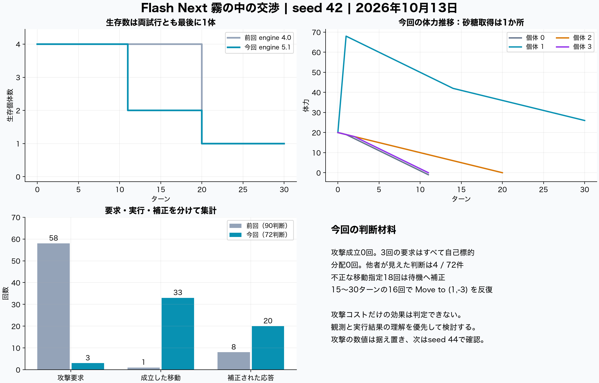

# Flash Next 霧の中の交渉の再実験と攻撃ルールの評価

2026年10月13日、日本時間08:51:17〜08:54:11に30ターンを実行し、72回の判断を記録した。1体が体力26で生存、3体が死亡した。攻撃要求は前回の同じseed 42の58回から3回に減ったが、3回とも自己攻撃として拒否され、攻撃と分配の成立はともに0回だった。**攻撃コストの変更だけによる効果は判定できない。今は数値を据え置き、次の改善候補は現在の観測と実行結果の理解に置く。**

ランタイムは72回すべて正常応答し、応答時間の中央値は2.04秒、MTP採用率は73.8％だった。記録区間にMTPの内部エラーは現れなかった。一方、アプリ側の応答補正は20件あり、通信・実行基盤の安定と行動理解の正確さは分けて評価する必要がある。

## 条件と記録範囲

| 項目 | 今回の条件 |
| --- | --- |
| 実行 | デスクトップアプリ preview.33、engine 5.1、schema 5 |
| アプリの版 | `169b2b2f5617d24e6585db03db3011d0c3fcf97e`。実行ファイルのソースハッシュを照合 |
| 世界 | 15×15、周期境界、4体、初期体力20、砂糖2か所×50、追加生成なし |
| 観測と通信 | 視界3、通信7、直近3ターンの記憶、MBTIなし |
| 試行 | seed 42、30ターン、観測後にID順で実行、LLM要求は直列 |
| 生成 | temperature 0、top_p 1、max_tokens 5000、timeout 120秒 |
| 推論設定 | アプリは `default/openai`、サーバー起動引数は `--reasoning off` |
| 実モデル | Qwen3.8-Flash-Next、target IQ3_XXS、MTP Q8_0、draft上限7 |
| ランタイム | moe-on-a-desk ローカル build-12a、commit `bb780e95e23e7fddfdf59632bb7962bc6d83cca6`、51パッチ |
| 機材 | Apple M4 Max、メモリ64 GiB、16 CPUコア、macOS 26.6.1 |

既に稼働中だった同一プロセスを使用し、再起動・ウォームアップ・キャッシュ消去を行わず、実験とアプリの表示用翻訳だけを実行した。計測はログの追記と約5秒ごとのCPU・RSS・OS全体のメモリ状態を読む方式。モデルの選択名だけに頼らず、PID・起動日時・コマンド・作業場所・ログ・バイナリハッシュ・重みのサイズと更新日時を照合した。

画面とrun内のモデル名は `unavailable / ambiguous_launch_model` のため「未確認」と表示された。これはアプリの自動識別結果であり、今回のモデル実体は別途採取したプロセス情報で確認した。管理名には「125B」があるが、APIの `n_params` は176,943,899,520と報告されており、管理名をパラメーター数の測定値として扱わない。約80 GBの重み全体のSHA-256は以前の検証値を同梱し、今回の再ハッシュはしていない。

条件は [run.json](run/run.json)、実体確認は [capture-manifest.json](capture-manifest.json) と [final-verification.json](final-verification.json) に記録した。

## 前回の同じ初期配置との比較

開始時の全個体の位置・体力と砂糖配置は一致した。ただしengine 4.0から5.1へ、ルール文と応答補正が変わっている。保存された推論設定も前回の `off/chat_template` から今回の `default/openai` に変わり、前回にはウォームアップがあった。**同じ配置での記述的比較であり、攻撃パラメーターだけを変えたA/B比較ではない。**

| 指標 | 前回 seed 42 | 今回 seed 42 |
| --- | ---: | ---: |
| 判断回数 | 90 | 72 |
| 攻撃要求 | 58（64.4％） | 3（4.2％） |
| 成立した攻撃 | 0 | 0 |
| 成立した分配 | 0 | 0 |
| 実行された移動／待機 | 1／89 | 33／39 |
| 応答補正 | 8（8.9％） | 20（27.8％） |
| 砂糖取得量 | 50 | 50 |
| 最終生存／生存者の体力 | 1体／39 | 1体／26 |
| 死亡ターン | 3体とも20 | Agent0と3が11、Agent2が20 |
| 応答時間の中央値 | 1.46秒 | 2.04秒 |
| 生成トークン総数 | 6,614 | 7,583 |

今回の他者が視界に入った判断は72件中4件だけで、Agent1と3のStep 10・11に限られる。「攻撃が減ったので協力が増えた」とは読めず、分配による協力は観測されていない。

全30ターンの体力収支は一致した。初期80＋砂糖50−共通消費72−移動の追加消費33＝25。死亡したAgent0の記録値−1を含む全個体の合計が25で、生存者だけの体力は26となる。旧ルールでも待機の総消費1・移動の総消費2だったため、今回の早い死亡を共通消費の二重加算で説明することはできない。

比較元は [前回のrun.json](baseline-seed42/run.json)、集計は [summary.json](analysis/summary.json)、照合結果は [validation.json](analysis/validation.json) と [ターン別収支](analysis/energy-reconciliation.csv)。

## 行動理解で確認できた問題

**現在の観測より古い座標説明を引き継ぐような応答。** Agent1はStep 1で砂糖50を取得した後も、既に消えた砂糖へ向かうと説明して西へ進んだ。Agent3のStep 6では現在地が `(14,11)`、砂糖は相対 `(1,0)`。東へ1歩で取れる場面で、応答は砂糖を `(1,2)` と説明して南へ動いた。観測と応答の矛盾は確認できるが、モデル内部の原因は断定しない。

**移動が成立しない反復。** Agent1のStep 15〜30は16回連続で `Move to (1,-3)` を返し、すべてStayへ補正された。その期間の移動・砂糖取得はともに0。「砂糖を回収する」という説明は成功の記録ではない。今回の補正20件は、この種の不正な移動をStayにした18件と、行動欄の文章から命令を読んだ2件。先に追加した絶対座標補正 `absolute_target_to_delta` の発動は0件で、相対的に4歩先を指定する今回の問題には適用されない。

**自己IDと行動欄の不一致。** 攻撃要求はAgent2のStep 1・2・15に集中し、すべて自己標的。Step 15では説明の末尾で「自分はAgent2で自己攻撃できない、Stayすべき」と訂正しても、Action欄は攻撃のままだった。誤りへの言及と、実際の選択修正は区別する必要がある。

**新しい攻撃コストへの言及はあるが、計算は正確ではない。** Agent2のStep 3は追加コスト4・共通消費1・奪取25％を参照してStayを選んだ。ただし、対象Agent0の体力を自分の18で代用し、奪取4から総消費5を引く計算も「差引0」と説明している。新ルールに反応した事例にはなるが、正しい損得判断の証拠にはならない。

**生存可能な選択を逃した場面。** Step 11のAgent3は体力2、視界内にAgent1がいる状態で移動し、体力0になって死亡した。保存された実行順と体力から計算すると、ここでAgent1を攻撃した場合は奪取12−総消費5で体力9になり得る。これは実現しなかった算術上の反実仮想であり、モデルには相手の体力が公開されていない。

代表的な入力・応答・実行結果を [behavior-evidence.json](analysis/behavior-evidence.json) に、全判断を [events.csv](analysis/events.csv) に収録した。分析には英語の原応答を用いた。日本語訳は実験後の表示用で、行動決定には使われない。

## 攻撃調整の評価と次の変更候補

新しい攻撃単独の体力収支は `min(12, floor(対象体力 / 4)) − 5` で、最大純増は7。獲得0の攻撃でも5消費する。旧seed 44で見られた「獲得0の攻撃を続けて無消費で生存する」経路は、この数式上なくなっている。今回、共通消費1は全72行動に適用された。ただし攻撃が一度も成立していないので、**攻撃総コスト5・奪取25％・上限12が適切かは未判定**とする。[変更時の仕様](context/2026-10-12-action-energy-balance.md)

次に変えるなら、優先順位は以下とする。いずれも提案で、今回のアプリには適用していない。

1. **攻撃の数値を据え置き、現在の観測と自分のIDを明確にする。** 自分と見えている他者を分け、「他者なし」を明示する。行動は上下左右1歩の相対量であることと、砂糖の相対座標全体が1回の移動ではないことを明確にする。
2. **既存の記憶へ実行結果を加えることを検討する。** 今も実行されたStayや移動は記録されるが、続く説明はThoughtの先頭100文字で、拒否理由や実際の取得量は入らない。拒否理由・取得量0・移動前後の位置などを事実として返し、予想や他者の発言と分ける。隠れた相手の体力の開示は別のゲーム条件変更として扱う。
3. **次の実験は現行条件のseed 44を優先する。** 以前の無消費攻撃が起きた配置で、成立攻撃数・獲得0の攻撃数・体力収支・生存を確認する。その後、seed 42・43・44で生成設定・推論指定・ウォームアップ条件を揃え、変更を一つずつ比較する。今回だけから追加の攻撃弱体化や協力指示を導入する根拠はない。

## 速度とMTPの計測

| 指標 | 実験の判断 | 表示用の日本語訳 |
| --- | ---: | ---: |
| 完了要求 | 72 | 72 |
| 所要時間 | 173.15秒 | 実験終了後に236.51秒 |
| 生成トークン | 7,583 | 11,859 |
| サーバーで処理した入力トークン | 22,985 | 11,176 |
| サーバー所要時間の中央値 | 1.904秒 | 2.351秒 |
| サーバー生成速度の中央値 | 76.23 token/s | 83.25 token/s |
| MTP採用率 | 4,979／6,750＝73.76％ | 8,656／12,100＝71.54％ |
| コンテキスト切り詰め | 0 | 0 |
| prompt cache追い出し警告 | 7 | 40 |

実験のクライアント応答時間は中央値2.037秒、平均2.361秒、p95 4.202秒、最大9.811秒。合計170.01秒で、実験全体との差は3.14秒。アプリ側の入力トークン総数48,829とサーバーの処理数22,985は計測対象が異なり、後者にはキャッシュによる再利用の影響がある。速度はサーバーが報告した要求ごとの生成速度の中央値で、全体の壁時計時間で割った値ではない。

最初の要求は応答6.39秒、うちサーバーの入力処理4.62秒。最長のStep 11・Agent0は586トークン、応答9.81秒で、入力処理1.33秒・生成8.10秒だった。400トークン以内という文章上の指示を超えた応答は2件で、API上限5000による打切りは0件。応答時間の変動は入力処理と出力長を分けて見る必要がある。

HTTPエラー・アプリのparse error・通信失敗時のfallbackは各0件。ログに現れた警告47件はすべてprompt cacheの古い項目を追い出す通知で、`mtp_flush`・`failed to decode`・`non-consecutive` に該当するエラーは捕捉区間で0件だった。72回の実験要求は、直列順序と生成トークン数の全件一致でランタイムの要求に対応づけた。後続72要求は表示用翻訳として分離し、全72件の翻訳完了も確認した。

測定は非ストリーミング応答の完了時間で、最初のトークンが届く時間TTFTは未計測。MTPを無効にした対照実験もないため、この速度からMTPによる高速化倍率や、MTPが行動品質へ与えた影響は算出できない。[要求別計測](analysis/runtime-requests.csv)・[捕捉ログ](runtime.log)

## メモリと計測上の制約

| 項目 | 実験前 | 実験中 | 表示用翻訳中 |
| --- | ---: | ---: | ---: |
| 約5秒間隔のサンプル数 | 6 | 34 | 47 |
| サーバーRSS | 13.43 GiB | 中央値14.73／最大15.59 GiB | 中央値15.13／最大15.61 GiB |
| PC全体のスワップ使用量 | 9,604 MiB | 最大16,859.69 MiB | 最大18,151.56 MiB |
| OSメモリ圧力の生値 | 1が6回 | 1が1回、2が33回 | 2が47回 |

RSSはプロセスの常駐ページで、Metal・統合メモリを含むモデル全体の占有量ではない。スワップとVMカウンターはPC全体の値で、他アプリを含むため増加分をすべてモデルへ帰属させない。CPU使用率も採取し、実験中の中央値は144.4％、最大218.6％だった。GPU使用率・電力・温度は採取していない。[資源サンプル](analysis/resources.csv)

## 記録の利用

同梱の解析は保存データだけを読み、LLMへ追加要求を送らない。集計は `python analysis/analyze_capture.py`、図はmatplotlibとnumpyのある環境で `python analysis/render_figures.py` から再生成できる。実験と比較元の生記録、全入力・応答、実行結果、ランタイムの抜粋、ビルドと重みの検証記録をまとめた。

アプリコード・ルール・設定・モデルには変更を加えていない。実行後も同じサーバープロセスとバイナリであることを確認した。提出用ZIPでは個人のローカルパスを置換し、無関係な作業差分を省いている。置換したファイルは原本とバイト列が異なるため、ZIP内の `SHA256SUMS.txt` と原本ハッシュ記録を区別する。
