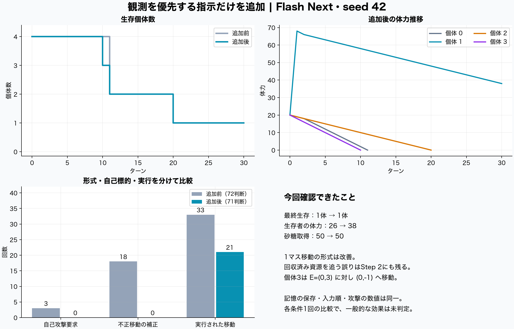
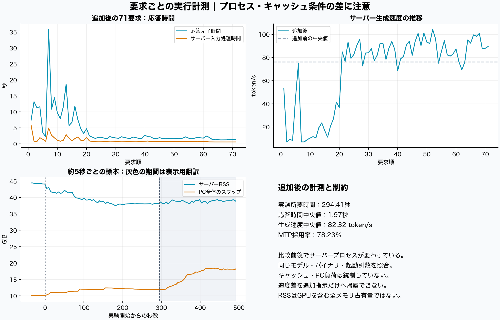

# Flash Next：現在の観測を優先する指示だけを追加した再実験

2026年10月13日、同じseed 42・engine 5.1で、現在の観測を優先する5段落だけを追加して30ターンを再実行した。**応答補正は20/72件から0/71件、自己攻撃要求は3件から0件になった。一方、砂糖取得は1か所・50のままで、生存数も1体のまま。合法な行動形式への追従は改善したが、資源への到達は改善していない。**

最終体力は26から38へ増えた。追加取得による増加ではなく、特にAgent1が早く待機へ切り替えて消費を抑えた結果である。(0,11) の資源はAgent3とAgent0の視界に入っていたが、移動方向を誤り、回収できなかった。

アプリ設定の差は `custom_world_prompt` のみ。記憶の保存方法・入力セクションの順番・攻撃の数値・応答補正コードを変えていない。ただし前後でサーバープロセスが変わり、今回の実験中には実験に対応しない2要求も混在した。**速度差は追加指示の効果として解釈できない。**

## 比較条件と追加した指示

| 項目 | 共通条件 |
| --- | --- |
| アプリ | preview.33、engine 5.1、schema 5、commit `169b2b2f5617d24e6585db03db3011d0c3fcf97e` |
| 世界 | 霧の中の交渉、15×15・周期境界、4体、初期体力20、砂糖2か所×50、追加生成なし |
| 観測・通信・記憶 | 視界3、通信7、直近3ターンの記憶、MBTIなし |
| 実行 | seed 42、30ターン、各ターンの観測後にID順で実行、アプリのLLM要求は直列 |
| 生成 | temperature 0、top_p 1、max_tokens 5000、timeout 120秒、アプリの推論指定 `default/openai` |
| モデル | Qwen3.8-Flash-Next、target IQ3_XXS、MTP Q8_0、draft上限7 |
| ランタイム | moe-on-a-desk ローカルbuild-12a、commit `bb780e95e23e7fddfdf59632bb7962bc6d83cca6`、51パッチ |
| 起動条件 | `--reasoning off`、コンテキスト16384、同時スロット1 |
| 機材 | Apple M4 Max、メモリ64 GiB、macOS 26.6.1 |
| 攻撃 | 共通消費1＋追加消費4、奪取25％、上限12、自己攻撃は禁止 |
| 比較元 | 同日08:51開始の直前試行。旧engine 4.0の試行ではない |
| 今回 | 09:32:57〜09:37:51（日本時間）、表示用翻訳は09:41:07に完了 |

既存の「世界の追加指示」欄を使い、元の英語ルールと同じ言語で次の内容を追加した。以下は日本語の要約で、実際の入力は [additional-instructions.txt](additional-instructions.txt) に全文を保存した。

1. 現在地・体力・見えている物について記憶と矛盾するときは、現在のLocal ViewとLATEST Statusを優先する。
2. 記憶の説明には予想や誤りが含まれ、成功を保証しない。過去の相対座標を現在地からの相対座標として使い回さない。
3. Eがなければ現在の視界内に資源がないという意味で、視界外の資源まで消えたことを意味しない。
4. 他者のメッセージは発言であり、行動や被害が起きた確定記録ではない。
5. 移動を選ぶなら、現在の観測に基づく上下左右1歩を指定し、資源全体の相対座標と今実行する1歩を区別する。

全71判断で「追加文＋元のsystem prompt」が完全一致した。Step 1の4体のuser promptは比較元と完全一致し、各体とも入力が181トークン増えた。開始時の位置・体力・砂糖配置、protocol、実行元ソースのハッシュも一致した。その後の位置・会話・記憶の**内容**は行動に応じて分岐しているが、生成・保存する**方法と順序**は同一である。[設定差分](configuration-validation.json)・[検証結果](analysis/validation.json)

## 行動と生存の比較

| 指標 | 追加前 | 追加後 |
| --- | ---: | ---: |
| 判断数 | 72 | 71 |
| 応答補正全体 | 20（27.8％） | 0（0％） |
| 不正移動をStayへ補正 | 18 | 0 |
| 文章から行動命令を抽出する補正 | 2 | 0 |
| 合法な移動／移動指定全体 | 33／51 | 21／21 |
| 実行された移動／待機 | 33／39 | 21／50 |
| 自己攻撃要求・拒否 | 3 | 0 |
| 成立した攻撃／分配 | 0／0 | 0／0 |
| 他者が視界に入った判断 | 4／72 | 0／71 |
| 砂糖の取得 | 1か所・50 | 1か所・50 |
| 最終生存／体力 | 1体／26 | 1体／38 |
| 死亡ターン | Agent0・3が11、Agent2が20 | Agent3が10、Agent0が11、Agent2が20 |
| 通信・解析エラー／fallback | 0／0 | 0／0 |

体力収支は全30ターンで一致した。今回は `初期80＋砂糖50−共通消費71−移動追加消費21＝38`。比較元は `80＋50−72−33＝25` で、死亡個体の記録値−1を含むため、生存者だけでは26だった。生存者の12増と、全個体の符号付き合計の13増を区別する。[ターン別収支](analysis/energy-reconciliation.csv)

追加後のAgent1はStep 1・2に移動し、Step 3〜30の28回はすべて待機した。攻撃や分配は成立しておらず、他者が見えた判断自体もないため、「協力性が増した」「攻撃コストの設定が適切」とは判断できない。

## 何が改善し、何が残ったか

**同じ初期入力での変化。** Step 1のAgent2は、追加前の自己攻撃からStayへ変わった。Agent3は `Move to (1,3)` から合法な `Move to (1,0)` に変わった。最初の4判断は観測・記憶・メッセージが同一なので、後の盤面の違いを含めずに比較できる。ただし各1応答の観測であり、再現率を測ったものではない。

**Agent1は古い資源説明を一度引き継いだ後、現在の観測へ戻った。** Step 1で50を取得済みなのに、Step 2ではEのないLocal Viewに対して「Memoryに相対(-1,0)の資源がある」と説明し、西へ進んで取得0。Step 3では「現在のLocal ViewにEがない」と判断し、待機へ切り替えた。追加前の資源追跡の反復は止まったが、追加指示への完全な追従ではない。

**(0,11) の資源は発見されていた。** 次の入力は実際にモデルへ渡された観測であり、モデルも説明内で座標を引用した。

| 場面 | 現在地と資源の相対座標 | 実際の移動と問題 |
| --- | --- | --- |
| Agent3・Step 1 | M=(14,8)、E=(1,3) | 東へ1歩で(0,8)へ。周期境界を越えて資源へ近づいた |
| Agent3・Step 2 | M=(0,8)、E=(0,3) | 「北へ3歩」と解釈し(0,-1)へ。資源までの距離が3から4へ増えた |
| Agent0・Step 9 | M=(3,11)、E=(-3,0) | 「北へ動けば近づく」と説明して(0,-1)へ。西にある資源から遠ざかった |
| Agent0・Step 11 | M=(3,9)、E=(-3,2) | 「北西」「北で縦の距離が2から1」と説明して(0,-1)へ。実際は縦の隔たりが増えた |

座標の新旧を区別するだけでは、座標から移動方向を決める誤りは解消しなかった。Agent3の誤りはyの符号、Agent0のStep 9は西の資源に北を選ぶ問題を含むため、南北の表記だけの問題とも断定しない。Agent3はStep 10、Agent0はStep 11に体力0で死亡した。

**死亡条件の読み違い。** Agent2のStep 20は現在の体力1を正しく読み、Stayで0になるとも計算したが、「0はそのターンを生き延びる最低値」と説明して待機し、実際には死亡した。現在値の認識とルール適用の正確さも別の評価項目となる。

原文の入力・応答・実行結果は [代表例](analysis/behavior-evidence.json) と [全判断](analysis/events.csv)、全盤面は [run.json](run/run.json) に保存した。分析は英語の原応答を基準にしており、実験後の日本語表示用翻訳は行動を決める入力には使っていない。

## 速度・MTP・要求の対応づけ

| 指標 | 追加前の実験 | 追加後の実験 |
| --- | ---: | ---: |
| 所要時間 | 173.15秒 | 294.41秒 |
| 応答時間の中央値 | 2.037秒 | 1.974秒 |
| 応答時間の平均／p95／最大 | 2.361／4.202／9.811秒 | 4.144／12.492／35.815秒 |
| 入力トークン（アプリ） | 48,829 | 61,086 |
| 入力トークン（サーバーが処理） | 22,985 | 22,936 |
| 生成トークン | 7,583 | 6,678 |
| サーバー生成速度の中央値 | 76.23 token/s | 82.32 token/s |
| MTP採用率 | 4,979／6,750＝73.76％ | 4,603／5,884＝78.23％ |
| コンテキスト切り詰め | 0 | 0 |
| 400トークンを超えた応答 | 2 | 0 |
| APIの出力上限による打切り | 0 | 0 |

今回、ランタイムのtask 198と391は実験の要求に対応しなかった。task 198は入力処理5,018・生成48トークンの計測値を持ち、task 391には完了時の生成計測値がない。両方にcancel通知があり、要求元は特定していない。この2件を実験のMTP・生成速度集計から除外した。

実験71件は、要求の順序、生成トークン数の完全一致、サーバーの最終コンテキスト長とアプリの入力＋生成トークン数の一致（差0または−1）を使って対応づけた。ログ全体の中で条件を満たす順序付き対応が一意であることを確認した。後続の表示用翻訳は71要求で、保存された翻訳71件と件数・時系列が一致し、全件完了した。翻訳にはトークン数が保存されないため、実験と同じ粒度のトークン照合はしていない。[対応づけ結果](analysis/runtime-requests.csv)

Step 2・Agent2のアプリ応答は35.815秒、対応するサーバー処理は14.952秒で、差は20.863秒。Step 4・Agent0も18.679秒に対して8.058秒で、差は10.621秒だった。実験外の要求処理と時系列が一致し、待ち時間が含まれたと考えられる。生成速度自体も序盤に約7〜20 token/sへ低下し、後半に回復した。**平均時間の悪化と中央値の改善を、単一の速度改善・劣化としてまとめない。**

前のPID 43459に対し、今回のPIDは42436（09:23:57起動）。新しい捕捉を始める前にプロセスが変わっていた。同一のバイナリハッシュ・起動引数・APIモデル情報・重みのサイズと更新日時を照合したが、キャッシュ状態やPC負荷は揃えていない。両実験とも実験担当側から再起動・予熱・キャッシュ消去は行っていない。速度差やMTP採用率の差を指示追加の因果効果としたり、MTPなしとの高速化倍率を算出したりすることはできない。

表示用翻訳は実験終了後に195.66秒、生成10,972トークン、生成速度中央値77.45 token/s、MTP採用率67.51％だった。実験中の警告は前述の実験外要求のcancel 2件、翻訳中はprompt cacheの追い出し11件。捕捉区間に `mtp_flush`・`failed to decode`・`non-consecutive` の内部エラーは現れず、実験71件にHTTP・parse・fallbackエラーはなかった。cancel通知をモデル内部エラーとして数えていない。[捕捉ログ](runtime.log)・[警告一覧](analysis/runtime-warnings.json)

## メモリと計測の限界

| 項目 | 実験中 | 表示用翻訳中 |
| --- | ---: | ---: |
| 約5秒間隔の標本数 | 58 | 40 |
| サーバーRSSの中央値／最大 | 38.64／43.02 GiB | 38.91／39.34 GiB |
| PC全体のスワップ最大 | 12,732.75 MiB | 18,891.25 MiB |
| サーバーCPU中央値／最大 | 186.2／227.0％ | 186.9／212.0％ |

RSSはMetal・統合メモリを含むモデル全体の占有量ではなく、スワップ・VMカウンターは他アプリを含むPC全体の値。前回とのRSS差をモデルの使用メモリ量の差と解釈しない。非ストリーミング応答の完了時間を測っており、TTFT・GPU使用率・電力・温度は未計測である。

アプリのモデル表示は今回も「未確認」で、実体確認は別途採取したプロセス情報で行った。モデル管理名には125Bがある一方、APIのn_paramsは176,943,899,520を返すため、管理名を実測パラメーター数として扱わない。重み全体のSHA-256は以前の検証値を同梱し、今回は約80 GBの再ハッシュを避けてサイズ・更新日時を確認した。[実体確認](capture-manifest.json)・[終了時検証](final-verification.json)

## 判断と次に切り分ける項目

今回の追加指示は、この1組の試行では行動形式と自己標的の問題を減らした。ただし、5段落を同時に追加したため、どの段落が寄与したかは分離できない。世界のseedは初期条件を固定するもので、モデルの推論乱数seedは固定していない。temperature 0でも、この1回から一般的な再現率は言えない。

次は、今回追加した指示と攻撃の数値を保ったまま、保存済み入力を使って「相対座標の符号と軸」「1歩後の資源までの距離」「体力0で死亡」の理解を個別に評価すると、原因を切り分けやすい。特に(0,11)の資源は発見済みなので、単に視界を広げる実験では今回の誤りに直接答えられない。攻撃の調整効果を見るseed 44は、これとは別の比較課題として残る。

以上は次の検討候補で、追加の指示・記憶形式・入力順・行動数値・コード変更や追加のモデル試験は行っていない。今回の追加文はアプリの追加指示欄に残している。

## 記録の利用

[追加前の記録](baseline-seed42/run.json)、[追加後の記録](run/run.json)、両者の計測値、全入力・原応答、表示用翻訳、実行元ソース、モデルとビルドの検証記録を同梱した。`python analysis/analyze_capture.py` で集計を再生成できる。図はmatplotlib・numpyと日本語フォントがある環境で `python analysis/render_figures.py` から再生成できる。いずれも保存済みデータを読むだけで、LLMに要求しない。

提出用ZIPでは個人のローカルパスを置換し、無関係な作業差分を除いた。元のファイルは変更せず、原本のハッシュと共有用ファイルのハッシュを分けて記録した。外部への提出は行っていない。
