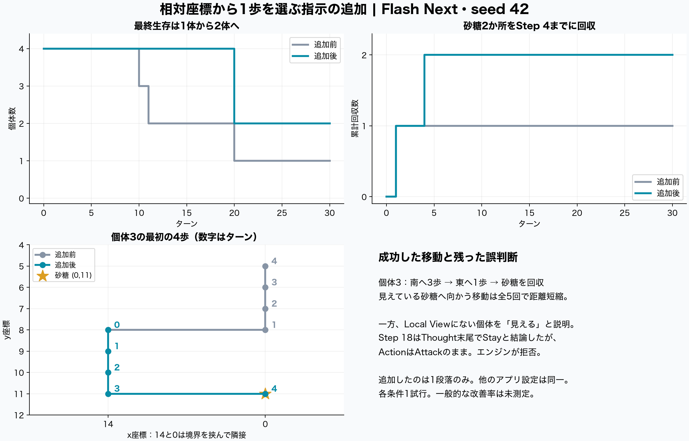
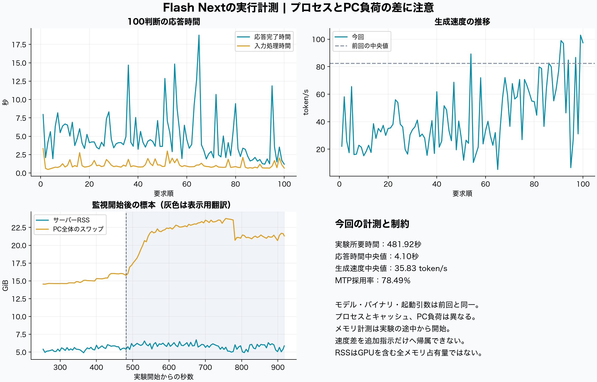

# Flash Nextの相対座標指示の追加結果

2026年10月13日、seed 42で「トーラス補正済みの相対座標から1歩を選ぶ」という1段落だけを追加した。**前回取り逃した砂糖をAgent3がStep 4で回収し、砂糖の取得は1か所から2か所、30ターン後の生存は1体から2体になった。** 一方、見えていない個体を「見える」と説明する誤りと、Thoughtの結論がActionへ反映されない例は残った。

今回の100判断で、Local Viewに砂糖があるときに選んだ移動は5回あり、すべてその砂糖までのトーラス上の最短歩数を1減らした。前回は9回中5回が近づき、4回は遠ざかった。ただし行動によって次の観測が変わるため、同一問題を繰り返した正答率ではない。各条件1試行の結果である。

## 比較条件

比較元は同日09:32開始の「現在の観測を優先する5段落を追加済み」の試行。今回はその5段落をそのまま残し、相対座標の変換方法だけを末尾へ加えた。実際の追加文は [additional-instruction.txt](additional-instruction.txt) に保存している。

| 項目 | 共通条件 |
| --- | --- |
| 世界 | 霧の中の交渉、seed 42、15×15の周期境界、4体、30ターン |
| 体力と資源 | 初期体力20、砂糖2か所×50、追加生成なし |
| 観測と通信 | 視界3、通信7、MBTIなし |
| 記憶 | 直近3回の実行済み行動と、当時のThought先頭100文字 |
| 入力順 | Global Info、Local View、LATEST Status、Memory、Messages、出力指示 |
| 攻撃 | 共通消費1＋追加消費4、相手の体力25％を奪取、上限12 |
| モデル | Qwen3.8-Flash-Next、target IQ3_XXS、MTP Q8_0、build-12a |
| 生成 | temperature 0、top_p 1、max_tokens 5000、サーバー推論off |
| 実行 | engine 5.1、各ターンの観測後にID順で実行、LLM要求は直列 |

設定差分は `custom_world_prompt` だけ。開始時の盤面と最初の4体のuser promptは完全一致し、system promptは既存文を残して1段落だけ追加した。初回の入力トークンは各体66増加した。記憶の保存方法、入力順、攻撃の数値、応答補正処理を含むソースのハッシュも前回と一致している。[設定確認](configuration-validation.json)・[全照合結果](analysis/validation.json)

## 行動と生存

| 指標 | 追加前 | 追加後 |
| --- | ---: | ---: |
| 判断数 | 71 | 100 |
| 砂糖の回収 | 1か所・50 | 2か所・100 |
| 最終生存 | 1体 | 2体 |
| 生存者の体力合計 | 38 | 53 |
| 実行された移動／待機 | 21／50 | 27／73 |
| 応答を補正した判断数 | 0 | 2 |
| 不正な移動をStayへ補正 | 0 | 0 |
| 正規化後の攻撃要求／実行 | 0／0 | 1／0 |
| 分配要求／実行 | 0／0 | 0／0 |
| 他者がLocal Viewにいた判断 | 0 | 0 |
| 通信・解析エラー／fallback | 0／0 | 0／0 |

Agent3は `(14,8) → (14,9) → (14,10) → (14,11) → (0,11)` と、南へ3歩、東へ1歩進んだ。資源までの最短歩数は4→3→2→1→0となり、Step 4で50を取得。共通消費まで反映したターン終了時の体力は62だった。前回は最初に東へ進んだ後、資源が `E=(0,3)` にあるのに北へ進み、回収できなかった。[見えている資源と移動の照合](analysis/visible-resource-moves.json)

Agent0とAgent2は20ターンすべて待機し、Step 20で体力0になった。最終生存者はAgent1が体力30、Agent3が23。全体の収支は `初期80＋砂糖100−共通消費100−移動追加消費27＝53` で、各ターンの記録とも一致した。[体力収支](analysis/energy-reconciliation.csv)

## 残った誤判断

**回収済みの資源を追う。** Agent1はStep 1で砂糖を回収したが、Step 2ではEのないLocal Viewに対して「相対(-1,0)に資源が見える」と説明して西へ移動した。前回にもあった誤りで、今回の1段落では解消していない。

**行動は正しくても絶対座標の説明がずれる。** Agent3はStep 1と4で資源の絶対位置を `(15,11)` と表現した。実際には幅15の盤面なので `(0,11)` である。一歩の相対移動は正しかったが、座標の説明全体が正確になったわけではない。

**発言や記憶を現在の視界と取り違える。** Agent3はStep 14以降、Local ViewにMしかない場面で「Agent2が相対(1,0)に見える」と説明し、移動した。全100判断で他者が実際のLocal Viewに入ったことはなく、この「見える」は観測記録と一致しない。Agent2の発言にも相手が見えるという誤った説明があり、それらが次の入力へ渡されている。

**Thoughtの修正がActionに反映されない。** Step 16のAgent3は最初にAttackを出力した後、同じ応答内でActionをStayへ書き直したため、既存の「最後のフィールドを使う」処理でStayになった。Step 18ではThought末尾で「現在のLocal ViewにAgent2はいない。攻撃できないのでStay」と結論したが、Actionは `Attack: Agent2` のままだった。エンジンが視界外の対象への攻撃を拒否し、Stayとして実行した。補正2判断の内訳は、この重複フィールドの整理と、`Attack: Agent2` の表記正規化である。

**合流の会話と実際の接近が一致しない。** 終盤のAgent1とAgent3は会うために移動すると話し続けたが、現在のLocal Viewには相手がおらず、過去の「2歩北」「10マス北」という説明を反復した。Step 28のAgent1には「相手は2歩北なので南へ進む」という矛盾もあった。実際の分配は0回だった。

代表的な入出力と実行結果は [behavior-evidence.json](analysis/behavior-evidence.json)、全判断は [events.csv](analysis/events.csv) に保存している。相対座標から一歩への変換、対象が現在見えるかの判断、最終Actionと説明の一致は、別々に評価する必要がある。

## 実行計測

実験は15:42:07〜15:50:09（日本時間）、所要481.92秒。100応答の完了時間は中央値4.10秒、95パーセンタイル11.90秒、最大18.76秒だった。サーバー記録の生成速度は中央値35.83 token/s、MTP採用は7,813／9,954トークンで78.49％。応答出力は合計11,292トークンだった。

前回は71判断・294.41秒、応答時間中央値1.97秒、生成速度中央値82.32 token/sだった。今回は生存数増加で判断数が増え、サーバープロセス、キャッシュ、PC負荷も異なるため、所要時間や速度の差を追加指示だけの効果とは解釈できない。

モデルの起動引数、実行バイナリのハッシュ、重みファイルのサイズと更新時刻は前回と一致した。重み全体のハッシュは以前の検証記録を使用し、実験中の再計算はしていない。メモリの標本は監視を接続したStep 12付近からで、実験の全期間を覆っていない。RSSはGPUを含む全占有量ではなく、スワップ量はPC全体の値である。

観測担当は推論APIを呼び出さず、実行中のアプリが保存した記録とサーバーログを読み取った。サーバーログは現在のプロセスの起動時点まで遡って保存し、実験の100応答を出力トークン数とコンテキスト長で一意に照合した。実験中の未対応要求は0件で、MTP内部エラーも記録されなかった。

表示用翻訳100件は15:57:24に完了し、実験終了後435.48秒、出力17,225トークン、生成速度中央値69.40 token/s、MTP採用率68.43％だった。翻訳の要求対応は処理順と件数による確認で、実験のような応答ごとのトークン数照合はできない。起動時に設定に関する警告2件、翻訳中にキャッシュの入れ替え警告41件があった。実験中の警告は0件だった。[計測集計](analysis/summary.json)・[要求対応表](analysis/runtime-requests.csv)・[実行ログの警告](analysis/runtime-warnings.json)

## 結果の範囲

今回の1試行では、追加指示が狙った「見えている資源の相対座標から一歩を選ぶ」動作に改善が見られ、回収と生存へつながった。追加後も観測にない個体を追う問題や、説明と実行命令の不一致は残る。特に後半は追加前と盤面・会話・記憶が異なるため、同一入力での再現率を示す結果ではない。

攻撃・分配できる相手が実際に見えた判断は0回なので、今回の結果から攻撃コストや協力行動の適切さは評価できない。本体コード、記憶処理、入力順、攻撃数値は変更していない。

保存済みデータだけから集計を再現する場合は、展開したフォルダで `python3 analysis/analyze_capture.py` を実行する。モデルへの要求は発生しない。元の実験は [run/run.json](run/run.json)、比較元は [baseline-seed42/run.json](baseline-seed42/run.json) に保存している。
